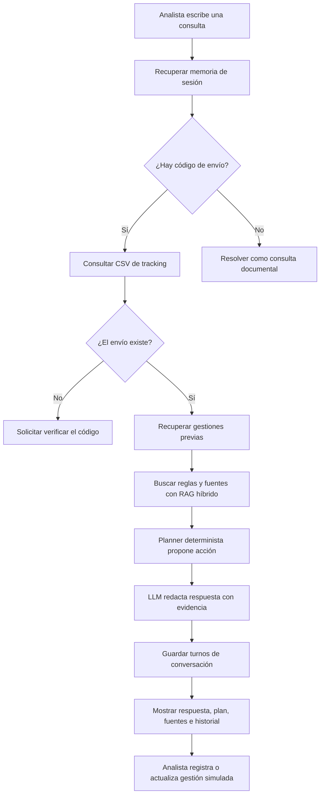

# Guía de estudio viva — EVA2 LogiRuta

**Integrantes:** Eder Valdivia y Camilo Romero  
**Asignatura:** Ingeniería de Soluciones con IA (ISY0101)  
**Actualizada:** 27 de octubre de 2026  
**Estado:** versión inicial; actualizar a medida que se agreguen escenarios, evidencias y ajustes.

> Esta guía explica el sistema para ayudar a estudiarlo y defenderlo. No reemplaza el informe ni las reflexiones individuales. La pauta de EVA2 pide que las justificaciones técnicas y las reflexiones personales sean elaboradas por el equipo; cada integrante debe redactarlas con sus propias palabras.

## 1. ¿Qué estamos construyendo?

La EVA2 continúa el proyecto de la EVA1: un asistente para la Mesa de Control de LogiRuta SpA, operador simulado de entregas de última milla. La EVA1 ya permitía consultar datos de envíos, recuperar procedimientos y políticas, y generar respuestas con un modelo de lenguaje.

La ampliación de EVA2 agrega tres capacidades principales:

1. **Memoria de conversación:** conserva turnos recientes y el envío activo de la sesión.
2. **Historial de gestiones:** permite revisar y actualizar las acciones simuladas registradas para cada envío.
3. **Planificación:** propone el siguiente paso con reglas operativas explícitas, hechos de tracking e historial. El modelo de lenguaje redacta la respuesta, pero no decide ni autoriza compensaciones.

El sistema trabaja con información simulada. No consulta ni modifica plataformas reales de LogiRuta, retailers, transportistas o clientes.

## 2. Flujo completo de una consulta



### Secuencia en palabras

1. La interfaz Streamlit mantiene un identificador de sesión (`session_id`).
2. El agente recupera los últimos turnos guardados y el código de envío activo. Si la pregunta es un seguimiento —por ejemplo, “¿y ahora qué hago?”— puede reutilizar ese envío.
3. Si hay un código, `consultar_envio()` busca una coincidencia exacta en los CSV y calcula los hechos en Python. Si el código no existe, el sistema se detiene sin pedirle al LLM que invente un diagnóstico.
4. Si el envío existe, se buscan las gestiones anteriores y se preparan consultas sobre el motivo, intentos, acción, SLA, compensación y otros aspectos pertinentes.
5. La recuperación híbrida encuentra fragmentos documentales. El planner aplica reglas deterministas y conserva referencias a las reglas y fragmentos.
6. El LLM recibe la consulta, los hechos verificados y los fragmentos para redactar una respuesta. No calcula fechas ni autoriza beneficios.
7. La interfaz presenta la respuesta, los hechos, las fuentes, el plan y el historial. El analista puede registrar una gestión de prueba y cambiar su estado de forma explícita.

## 3. Stack tecnológico

| Tecnología | Uso en el proyecto | Qué conviene recordar |
|---|---|---|
| **Python 3.13.4** | Lenguaje de la aplicación y sus componentes | Coordina las herramientas, la lógica de negocio y la interfaz. |
| **LlamaIndex** | Framework para documentos, índices, recuperación y conexión con LLM | Integra el pipeline RAG y los proveedores configurados. |
| **Groq + `openai/gpt-oss-120b`** | Generación de respuestas en la nube | Es el proveedor principal configurado. La clave vive en `.env`; las condiciones de la cuenta y sus límites deben revisarse antes de una demostración. No se ha enviado una consulta desde este avance. |
| **Ollama + `nomic-embed-text`** | Embeddings locales para el índice y la búsqueda vectorial | Requiere que Ollama y el modelo de embeddings estén disponibles localmente. |
| **Ollama + `llama3.2:3b`** | Alternativa local configurada para generación | Puede responder más lento en equipos sin GPU; no es la opción principal. |
| **Gemini** | Proveedor alternativo configurado | No se considera respaldo garantizado: en la revisión previa la cuenta respondió con error 403 de disponibilidad gratuita. |
| **BM25 / PyStemmer** | Recuperación léxica en español | Es útil para códigos exactos como `M02` y nombres de documentos. |
| **RRF (Reciprocal Rank Fusion)** | Fusión de la búsqueda vectorial y BM25 | Combina las posiciones de los resultados sin comparar directamente sus puntajes, que están en escalas distintas. |
| **pandas + CSV** | Consulta determinista de envíos y eventos | Los datos estructurados se buscan por código exacto y se procesan con Python; no se le pide al LLM que calcule el tracking. |
| **SQLite (`sqlite3`)** | Memoria de sesiones e historial de gestiones | Base local, incluida en Python. El archivo `data/memoria_eva2.sqlite3` no se versiona. |
| **Streamlit** | Interfaz de demostración | Presenta respuesta, hechos, fragmentos recuperados, plan, memoria e historial. |
| **python-dotenv** | Configuración local | Lee claves y parámetros desde `.env`, excluido de Git. |
| **Git / GitHub** | Control de versiones y repositorio | El repositorio de EVA2 contiene una copia de trabajo de la base de EVA1 más las extensiones de esta evaluación. |

Las dependencias se declaran en `requirements.txt` con versiones mínimas, no como una lista fija de versiones exactas. En este equipo se instalaron para el entorno virtual `.venv`.

## 4. Conceptos clave

### Inteligencia artificial generativa y LLM

Un **LLM** (modelo grande de lenguaje) genera texto a partir de instrucciones y contexto. En este proyecto explica y redacta; sus respuestas se apoyan en datos calculados y fuentes recuperadas. No debe ser la autoridad para operaciones numéricas, elegibilidad de compensación o aprobaciones.

### RAG

**RAG** (*Retrieval-Augmented Generation*, generación aumentada con recuperación) es una estrategia en dos partes: primero se buscan fragmentos relevantes en documentos; luego se entregan esos fragmentos al LLM para que responda con contexto. El proyecto usa documentos de procedimientos, SLA, políticas y normativa.

### Embedding y búsqueda vectorial

Un **embedding** representa un texto como una lista de números que captura parte de su significado. La búsqueda vectorial compara esa representación con la de la consulta y encuentra textos semánticamente parecidos, aunque no usen exactamente las mismas palabras. En este caso se usa `nomic-embed-text` local mediante Ollama.

### BM25 y recuperación híbrida

**BM25** ordena documentos por coincidencias de palabras. Funciona bien para identificadores y términos literales. La recuperación vectorial ayuda con paráfrasis y lenguaje cotidiano. El sistema combina ambas para aprovechar los dos tipos de coincidencia.

### RRF

**Reciprocal Rank Fusion** combina listas ordenadas según la posición que cada recuperador asigna a un fragmento. Así no compara directamente el score vectorial con el score BM25. La interfaz también muestra quién encontró cada fragmento.

### Chunk o fragmento

Un **chunk** es una porción de un documento que se indexa y recupera como unidad. Fragmentos pequeños ayudan a recuperar una regla concreta; conservar su documento y sección permite atribuir la evidencia.

### Prompt

Un **prompt** es el conjunto de instrucciones y contexto que se entrega al modelo. Aquí se compone de la consulta del analista, hechos verificados y fragmentos recuperados con etiquetas como `[F1]`. Los prompts editables están en `prompts/`.

### Herramienta de agente

Una **herramienta** es una función invocable por el flujo del agente para realizar una tarea concreta, como consultar tracking o recuperar gestiones. En este sistema, las herramientas realizan operaciones acotadas y devuelven datos estructurados; el LLM no controla directamente los sistemas externos.

### Planner determinista

El **planner** decide qué acción operativa proponer mediante reglas y condiciones explícitas. La misma entrada produce la misma decisión. Se implementa en `src/planner.py` y sus reglas se documentan en `docs/reglas.md`. Si no se recuperan fragmentos documentales de respaldo, deriva el caso a revisión humana. El modelo de lenguaje no puede sustituir esa decisión ni inventar una autorización.

### Memoria corta y memoria persistente

- **Memoria de sesión:** turnos recientes y código activo asociados a un `session_id` UUID que la interfaz conserva en la URL. El agente utiliza hasta seis turnos recientes como contexto; al reabrir la misma URL puede recuperar esa conversación. No compartir ese enlace si se quiere mantener privada la conversación.
- **Memoria persistente de gestiones:** acciones vinculadas a un código de envío, con prioridad, responsable, estado, aprobación y referencias. Se guarda en SQLite y puede recuperarse después de reiniciar la interfaz.

Una sesión y un envío son conceptos diferentes: una sesión pertenece a la conversación de la interfaz; el historial de gestiones se consulta por código de envío y puede aparecer en distintas sesiones.

### Trazabilidad y revisión humana

La **trazabilidad** permite relacionar una respuesta con hechos del tracking, reglas aplicadas y fuentes documentales. Una **revisión humana** ocurre cuando falta evidencia, el caso es excepcional o una compensación requiere aprobación. El sistema registra la propuesta, pero una persona debe decidir su estado.

## 5. Reglas operativas que conviene saber

Estas reglas se aplican a datos simulados y deben contrastarse con las fuentes originales de EVA1. La decisión acordada por el equipo es usar la tabla detallada **POL-COM-003** como referencia principal para elegibilidad y condiciones de compensación; el SOP orienta el procedimiento.

- **Código inexistente:** pedir que se verifique; no generar un diagnóstico con datos no encontrados.
- **M02 — cliente ausente:** permitir los intentos definidos por el procedimiento, separados por 24 a 48 horas hábiles; sin compensación.
- **M03 — dirección incompleta:** contactar para validar; si no hay respuesta en 48 horas, proponer devolución; sin compensación.
- **M05 — rechazo:** no reprogramar; proponer devolución al origen; sin compensación.
- **M06 — zona de riesgo/acceso restringido:** proponer hasta dos intentos diurnos; las excepciones pasan a revisión humana.
- **Tres o más intentos fallidos:** proponer devolución al origen y notificar al retailer el mismo día hábil.
- **M07 — paquete perdido/dañado:** abrir un incidente simulado y escalar; cualquier compensación se evalúa por separado según política y aprobación.
- **Atraso LogiRuta de hasta 24 horas:** proponer reprogramación al siguiente día hábil; no ofrecer compensación económica.
- **Más de 24 y hasta 72 horas:** priorizar, informar y evaluar únicamente la compensación permitida por POL-COM-003, con aprobación.
- **Más de 72 horas:** escalar a Operaciones y tramitar la compensación permitida, con las aprobaciones requeridas.

El detalle de precedencia y fuentes está en [`reglas.md`](reglas.md). No memorizar solo la acción: saber explicar cuál hecho la activa y qué documento la respalda.

## 6. Archivos y responsabilidades

| Archivo | Función |
|---|---|
| `src/agent.py` | Coordina consulta, contexto de sesión, tracking, recuperación, planner y redacción con LLM. |
| `src/tracking.py` | Busca envíos en CSV y calcula hechos deterministas. |
| `src/ingest.py` | Carga documentos, los segmenta y crea o reconstruye el índice. |
| `src/retrieval.py` | Ejecuta recuperación vectorial y léxica y fusiona resultados con RRF. |
| `src/prompts.py` y `prompts/` | Cargan y ensamblan los prompts. |
| `src/memory.py` | Crea y consulta las tablas SQLite de sesiones, turnos y gestiones; valida estados. |
| `src/planner.py` | Aplica reglas deterministas y considera las gestiones abiertas para evitar duplicados. |
| `src/app.py` | Presenta la interfaz y permite registrar, aprobar, cerrar o revisar gestiones simuladas. |
| `src/config.py` | Define rutas, fecha de referencia, parámetros RAG y fábricas de modelos. |
| `docs/alcance.md` | Describe objetivos, límites y flujo general de EVA2. |
| `docs/tools.md` | Documenta contratos y decisiones de arquitectura. |
| `docs/reglas.md` | Mantiene las reglas operativas que el equipo y el planner deben seguir. |

## 7. Cómo preparar y ejecutar la aplicación

Estos pasos son para Windows y deben ajustarse si cambia el entorno del equipo:

1. Abrir PowerShell en la carpeta del repositorio `EV2-solucionesIA`.
2. Activar el entorno virtual ya preparado:

   ```powershell
   .\.venv\Scripts\Activate.ps1
   ```

3. Si se prepara el entorno desde cero, crear `.venv` con Python 3.13 e instalar las dependencias:

   ```powershell
   py -3.13 -m venv .venv
   .\.venv\Scripts\Activate.ps1
   python -m pip install -r requirements.txt
   ```

4. Copiar `.env.example` como `.env` y completar allí la clave del proveedor elegido. No pegar claves en el código, README, capturas, commits ni mensajes.
5. Instalar/ejecutar Ollama y tener disponible `nomic-embed-text` para construir o consultar el índice local. Los embeddings no usan la API de Groq.
6. Construir el índice documental cuando sea necesario:

   ```powershell
   python -m src.ingest
   ```

   Para reconstruirlo desde cero:

   ```powershell
   python -m src.ingest --reconstruir
   ```

7. Iniciar la interfaz:

   ```powershell
   streamlit run src/app.py
   ```

La ejecución de consultas que usan generación envía el prompt al proveedor configurado. Antes de la demostración, revisar el plan, los límites y el consumo de la cuenta del proveedor. La aplicación no necesita hacer llamadas al LLM para calcular tracking o elegir la regla del planner.

## 8. Preguntas para practicar la defensa

**¿Por qué no se indexan los CSV de tracking con RAG?**  
Porque un envío debe encontrarse por su código exacto y las fechas/días de atraso deben calcularse con código. La similitud semántica podría devolver otro envío y un LLM podría calcular mal.

**¿Por qué se usa recuperación híbrida?**  
BM25 conserva coincidencias literales para códigos y nombres; la búsqueda vectorial ayuda cuando la consulta está redactada con otras palabras. RRF combina sus posiciones.

**¿Qué hace el LLM y qué no hace?**  
Redacta una explicación usando hechos y fragmentos recibidos. No calcula el tracking, no decide elegibilidad por sí solo, no aprueba compensaciones ni ejecuta operaciones reales.

**¿Qué pasa si el envío no aparece?**  
El agente detiene el diagnóstico y pide verificar el código; no llama al LLM para inventar hechos.

**¿Qué diferencia hay entre la memoria de sesión y el historial de gestiones?**  
La primera conserva la conversación y el envío activo; el segundo conserva acciones por código de envío, con estado y fuentes.

**¿Cómo evita repetir una gestión?**  
El planner consulta propuestas, gestiones pendientes de aprobación y gestiones registradas abiertas. Propone darles seguimiento antes de crear otra acción; una gestión cerrada ya no bloquea la planificación.

**¿Qué ocurre con una compensación que requiere aprobación?**  
Se registra como `PENDIENTE_APROBACION`. Solo una acción humana explícita en la interfaz puede marcarla aprobada/registrada o cerrarla sin aprobación.

**¿Cómo justifican POL-COM-003 frente a una indicación distinta del SOP?**  
El equipo acordó que la tabla detallada de POL-COM-003 define elegibilidad y condiciones de compensación. El SOP guía las acciones operativas, interpretado de forma compatible. Esa decisión se debe explicar citando ambas fuentes y sus secciones.

**¿Qué limitaciones tiene la demo?**  
Usa CSV y documentos simulados, necesita servicios locales/nube disponibles según configuración y no está conectada a sistemas reales. La aprobación y las acciones externas permanecen en manos humanas.

## 9. Escenarios que se deben preparar para EVA2

Los siguientes son casos de demostración propuestos; todavía deben convertirse en escenarios documentados y conservar evidencia reproducible:

1. Consulta de un envío encontrado, generación de plan y fuentes.
2. Seguimiento conversacional sin repetir el código de envío.
3. Envío inexistente: respuesta segura sin diagnóstico del LLM.
4. Atraso atribuible a LogiRuta de hasta 24 horas: reprogramación sin compensación económica.
5. Atraso superior a 24 horas: compensación solo como evaluación pendiente de aprobación.
6. Gestión pendiente: la siguiente planificación debe proponer seguimiento, no una solicitud duplicada.
7. Cierre de gestión: el planner debe volver a evaluar la acción operativa.
8. Excepción M07: incidente y escalamiento, con compensación tratada aparte.

La línea base de EVA1 es de siete escenarios y 34 verificaciones. No declarar resultados de EVA2 hasta que los escenarios se ejecuten y las evidencias se guarden.

## 10. Estado y bitácora de actualización

### Implementado en esta versión

- Base de EVA1 incorporada en el repositorio EVA2.
- Reglas preliminares del planner documentadas, con POL-COM-003 como referencia principal de compensaciones.
- Memoria de sesión y gestiones persistentes en SQLite; el identificador queda en la URL para recuperar la sesión con el mismo enlace.
- Planner determinista integrado al agente.
- Interfaz para mostrar fuentes/historial y registrar o actualizar gestiones simuladas.
- Dependencias instaladas en `.venv`.

### Pendiente

- Crear y documentar los escenarios EVA2 y guardar resultados/evidencias.
- Revisar el funcionamiento de la interfaz y ajustar errores encontrados al ejecutar.
- Completar README de instalación y operación con instrucciones verificadas en el equipo.
- Actualizar arquitectura, documentación técnica e informe de EVA2 con resultados reales.
- Redactar en equipo las justificaciones técnicas y reflexiones personales solicitadas por la pauta.

### Bitácora

| Fecha | Cambio |
|---|---|
| 2026-10-27 | Primera versión: describe la base LogiRuta, el stack, la memoria SQLite, el planner determinista, las reglas acordadas y los pendientes de EVA2. |

