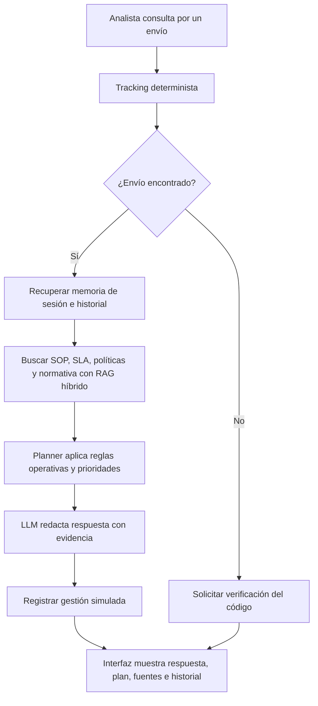

# Alcance del agente LogiRuta

**Integrantes:** Camilo Romero y Eder Valdivia

## Base de la EVA1

El proyecto de la EVA1 es un asistente para la Mesa de Control de LogiRuta SpA, un operador simulado de última milla. Ayuda a diagnosticar retrasos y excepciones de entrega usando dos fuentes: datos estructurados de tracking y documentos con procedimientos, SLA, compensaciones y normativa.

La base ya incluye consulta determinista de envíos, recuperación híbrida RAG (búsqueda densa y BM25 con fusión RRF), generación con LlamaIndex y Groq, interfaz Streamlit y evidencia de siete escenarios.

## Alcance propuesto para la EVA2

La EVA2 extiende el agente existente para que pueda:

- Mantener el contexto de la conversación durante una sesión y recuperar gestiones anteriores del envío.
- Planificar la siguiente acción operativa según los hechos del tracking, el procedimiento aplicable, el SLA y el historial.
- Registrar cada gestión simulada con acción, responsable, estado y fuentes que la respaldan.
- Responder con evidencia trazable y mostrar el plan y el historial en la interfaz.

## Límites

- Se trabaja con datos simulados; no se conectan sistemas reales de tracking, CRM, transportistas ni clientes.
- El agente propone y registra acciones de prueba; no reprograma entregas, envía mensajes ni autoriza compensaciones reales.
- Los casos con antecedentes incompletos, reglas ambiguas o aprobación requerida se derivan a revisión humana.
- El agente no emite asesoría legal ni reemplaza a la Mesa de Control.

## Criterios de avance

- Preservar los siete escenarios y las 34 verificaciones de la EVA1 como línea base.
- Añadir escenarios que comprueben continuidad de contexto, recuperación de gestiones previas y decisiones distintas ante condiciones operativas distintas.
- Cada decisión debe conservar los hechos, reglas y fragmentos recuperados que la respaldan.

## Flujo de trabajo

